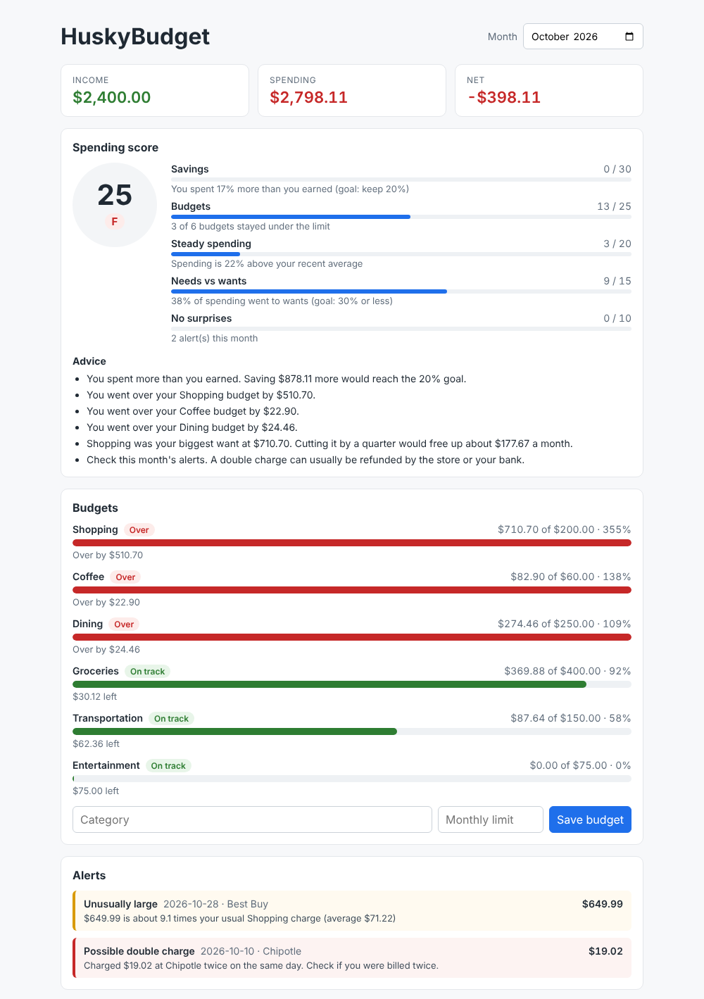

# HuskyBudget

A personal budgeting web app with a **C++17 backend**. One C++ program is both the web server and the engine that does all the math. The browser page only shows the results.



## What it does

| Feature | What you see |
|---|---|
| **Track spending** | Add and delete income and expenses, each with a date, amount, category, and store |
| **Monthly summary** | Money in, money out, what's left, and a bar chart of where it went |
| **Bank import** | Load a CSV file from your bank instead of typing everything in |
| **Budgets** | Set a monthly limit per category. Each budget shows **On track**, **At risk**, or **Over**, and warns you *before* you overspend |
| **Alerts** | Flags double charges, charges far bigger than normal, big buys at new stores, and sudden bursts of spending, each with a plain-English reason |
| **Spending score** | A 0–100 score and letter grade, a breakdown of how every point was earned, and advice |
| **What if?** | "If I saved $200 a month at 7% for 10 years, I'd have $34,616.96" |
| **Auto-save** | Everything is saved to a file and is still there next time |

## How it works

### Budgets: warning you early

A plain progress bar would say a Coffee budget is fine at 26% used. HuskyBudget looks at the **pace** instead:

```
spent so far ÷ days so far × days in the month = end-of-month guess
$15.68       ÷ 8           × 31                = $60.76   → over the $60 limit: At risk
```

For the first 6 days of a month the pace isn't trusted, because one purchase isn't a trend.

### Alerts: four simple rules

| Alert | Rule |
|---|---|
| Possible double charge | Same store, same amount, same day as an earlier charge |
| Unusually large | At least 1.5× your average in that category **and** more than 2.5 standard deviations above it. Needs at least 5 earlier charges to know what's normal |
| Big buy, new store | $200 or more at a store you've never used, once there's 30+ days of history |
| Spending burst | 5+ purchases in one day **and** at least 3× your usual purchases per day |

Every alert explains itself, for example: *"$649.99 is about 9.1 times your usual Shopping charge (average $71.22)"*.

### Spending score: 100 points, all explainable

| Part | Points | Full points when… |
|---|---|---|
| Savings | 30 | you keep 20%+ of your income |
| Budgets | 25 | every budget stays under its limit |
| Steady spending | 20 | you spend no more than your last-3-months average (25% over = 0) |
| Needs vs wants | 15 | 30% or less goes to Dining, Coffee, Shopping, Entertainment (50% = 0) |
| No surprises | 10 | there are no alerts (−5 each) |

Grades: A 90+, B 80+, C 70+, D 60+, F below 60. Each thing that costs points produces one tip.

### What if: compound savings

Deposits at the end of each month, interest added monthly:

```
balance = monthly × ((1 + r)ⁿ − 1) ÷ r       r = yearly rate ÷ 12,  n = months
```

## How it's built

```
Browser (HTML + CSS + JavaScript)
   │  asks for data over HTTP, gets JSON back
   ▼
Web server            apps/server_main.cpp
   │  reads the request, calls one function, sends JSON back
   ▼
Engines               Summary, BudgetStatus, Alerts, Score, WhatIf, CsvImporter
   │  pure calculations: no storage, no web code
   ▼
Repository            "add / delete / find" (an interface)
   │  InMemoryRepository  ←  JsonFileRepository (saves to data/huskybudget.json)
   ▼
Data types            Money, Date, Transaction, Budget
```

- **Each layer only talks to the one below it.** The engines don't know a web server exists, so they're tested directly in milliseconds.
- **Storage can be swapped.** Everything uses the `Repository` interface, so a database could replace the JSON file without changing other code.
- **The server is thread-safe.** It handles several requests at once, and a `std::mutex` makes sure only one touches the data at a time.

### Design decisions

- **Money is stored as whole cents (`int64`), never as decimals.** `0.1 + 0.2` isn't exactly `0.3` in floating point; `10 + 20` is always `30`. The one exception is the what-if calculator, where compound interest needs powers like 1.00583¹²⁰. It rounds back to whole cents right away.
- **Typed amounts are read digit by digit.** `"1.005"` as a `double` is really `1.00499…`, which would round to the wrong cent.
- **Bad input is rejected, not guessed at.** `"abc"` as an amount, or `2026-02-30` as a date, gets a clear error message.
- **Statistics instead of AI.** Every alert and score comes from a rule that can be explained in one sentence and checked by a test.
- **CSV import is all or nothing.** If any row is bad, nothing is imported and every problem is listed by line number.

## Tech

| Part | Choice |
|---|---|
| Language | C++17 |
| Build | CMake + Ninja |
| Compiler | GCC (MinGW-w64 via MSYS2 on Windows) |
| Web server | [cpp-httplib](https://github.com/yhirose/cpp-httplib) (single header) |
| JSON | [nlohmann/json](https://github.com/nlohmann/json) (single header) |
| Tests | [doctest](https://github.com/doctest/doctest) (single header) |
| Frontend | Plain HTML, CSS, JavaScript (no frameworks, no build step) |
| Storage | JSON file |

## Running it

You need a C++17 compiler, CMake, and Ninja. The three libraries are already in `third_party/`.

**Build** (or click **⚙ Build** in VS Code with the CMake Tools extension):

```
cmake -S . -B build -G Ninja
cmake --build build
```

**Run** from the project folder, the one that contains `web/`:

```
.\build\tests.exe              # run all the tests
.\build\seed.exe --force       # fill the app with 12 months of sample data + 6 budgets
.\build\huskybudget.exe        # start the server
```

Then open **http://localhost:8080**. Press **Ctrl + C** to stop the server, and stop it before rebuilding.

The sample data includes a $649.99 TV purchase and a double Chipotle charge in the last full month, so the alerts have something to find.

## Tests

**98 test cases**, all in `tests/`, run in under a second. Some examples:

- Ten 10-cent charges add up to exactly $1.00. `"1.005"` is read as $1.01, and `"abc"` is rejected.
- 2024 is a leap year and 1900 isn't. February 30th is rejected.
- Saved data comes back exactly after a restart. A broken file gives a clear error.
- The Coffee example: 26% used, but on pace for $60.76, so **At risk**.
- A double charge is flagged once (the second charge), and a $20 → $95 grocery trip is flagged. Normal ups and downs aren't.
- $200 a month at 7% for 10 years is exactly $34,616.96.

## API

| Method | Path | What it does |
|---|---|---|
| GET | `/api/transactions?month=2026-10` | Transactions for a month (or `?from=&to=`) |
| POST | `/api/transactions` | Add a transaction |
| DELETE | `/api/transactions/{id}` | Delete a transaction |
| POST | `/api/import` | Import a CSV file (body = the file's text) |
| GET | `/api/summary?month=2026-10` | Money in, money out, net, spending by category |
| GET | `/api/budgets?month=2026-10` | Every budget's status and end-of-month guess |
| PUT | `/api/budgets` | Add a budget or change its limit |
| GET | `/api/alerts?month=2026-10` | Alerts for the month |
| GET | `/api/score?month=2026-10` | Score, breakdown, and advice |
| GET | `/api/whatif?monthly=200&rate=7&years=10` | Savings projection |

Every amount is sent as both a display string and exact cents: `{"display": "$12.50", "cents": 1250}`.

## Project layout

```
huskybudget/
├── apps/          server_main.cpp (web server), seed_main.cpp (sample data)
├── include/budget/  headers: one per type or engine
├── src/           the matching .cpp files
├── tests/         one test file per engine
├── web/           index.html, app.js, style.css
├── third_party/   httplib.h, json.hpp, doctest.h
├── data/          huskybudget.json (your data; not in git)
└── CMakeLists.txt
```

## Known limitations

These are deliberate choices to keep the project finishable and correct:

- One user only. There's no login.
- Data lives in a JSON file, not a database (the code is ready for one).
- Runs on your own computer (`localhost`) without HTTPS.
- The pace guess assumes steady spending, so a big one-time bill early in the month can make a budget look at risk.
- Categories are matched exactly ("dining" and "Dining" are different).
- Advice comes from fixed rules, not learned from data.

## Ideas for later

- Swap the JSON file for SQLite through the same `Repository` interface
- Run the tests automatically on every push (GitHub Actions)
- Performance testing with 1 million transactions
- Real login with secure password hashing